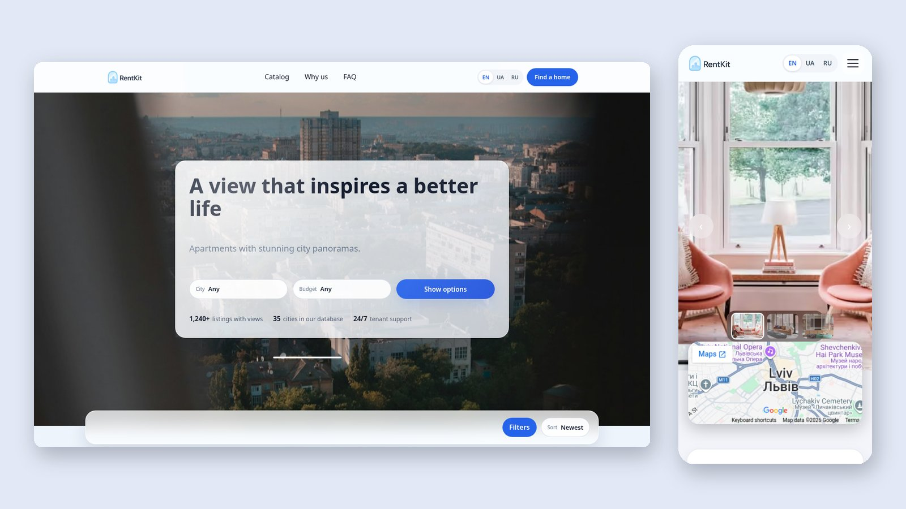

# RentKit

A rental catalog for apartments, houses and studios, built with plain HTML, CSS and JavaScript modules. No frameworks, no build step. It is available in three languages and covers accessibility and performance.

🔗 **Live demo:** https://den-dev-web.github.io/rentkit/



---

## ✨ Features

**Catalog (home page)**

- Quick search in the hero section (city and budget).
- Filters in a modal: city, price, rooms, property type and "available only".
- Active filters shown as removable chips.
- Sorting by date or price.
- "Show more" loading, skeleton placeholders and an empty state when nothing matches.
- Accessible FAQ accordion.

**Property page**

- Photo gallery with thumbnails and an embedded map.
- Specifications, highlights and guest reviews.
- Availability calendar: a mini view plus a 3-month modal. Booked dates are computed relative to today, so the demo never goes stale.
- "Contact the owner" modal with form validation and a success state. There is no backend, so the form only shows the confirmation.
- A "Property not found" state for unknown IDs.

**Languages: English (default), Ukrainian, Russian**

- Switcher in the header. The choice is saved and can be shared through `?lang=uk`.
- Number formats, month and weekday names come from `Intl`.
- Plural forms come from `Intl.PluralRules` ("1 review", "24 відгуки", "36 відгуків").

---

## 🧩 Technical highlights

**Accessibility**

- Semantic landmarks and one `h1` per page with no skipped heading levels.
- Menus, filters (including the custom dropdowns), modals and gallery arrows work with the keyboard.
- Focus stays inside open modals and returns to the trigger on close.
- `Esc` closes the topmost layer first.
- Hidden modals cannot be reached with Tab.
- Respects `prefers-reduced-motion`: no slider autoplay, no parallax and no zoom animations.
- Hover effects apply only on devices with a mouse (`@media (hover: hover)`).

**Performance**

- Gallery photos are served through `<picture>` with AVIF and WebP.
- Every image has `width` and `height`, so the layout does not shift (CLS 0).
- The hero heading is in the HTML, so it paints right away and is the LCP element.
- Below-the-fold images are lazy-loaded.

**SEO**

- Meta description, canonical URL, Open Graph and Twitter card.
- `<html lang>` and the page title follow the selected language.

**Architecture**

- CSS split into layers: `tokens` → `base` → `typography` → `layout` → `components` → `utils` → `animations`.
- BEM class names.
- One JS module per responsibility, initialised from two entry points (`js/main.js` and `js/property.js`).
- Data lives in a local module instead of an API. Its texts are stored as `{ en, uk, ru }` and localised once, when the module loads.

Lighthouse (local run, mobile simulation):

| Page | Performance | Accessibility | Best practices | SEO |
| --- | --- | --- | --- | --- |
| Home | 99 | 100 | 100 | 100 |
| Property | 87 | 100 | 100 | 100 |

---

## 🗂️ Project structure

```
├── index.html            # catalog
├── property.html         # property details
├── css/
│   ├── tokens.css        # colors, spacing, typography scale
│   ├── base.css, typography.css, layout.css, utils.css, animations.css
│   └── components/       # header, hero, filters, card, property, faq, footer…
├── js/
│   ├── main.js           # home page entry point
│   ├── property.js       # property page entry point
│   ├── modules/          # catalog, property, i18n, header, hero-slider, faq, reveal…
│   ├── i18n/             # en.js, uk.js, ru.js dictionaries
│   ├── utils/motion.js   # prefers-reduced-motion helpers
│   └── data/properties.js
└── assets/               # icons and images (JPG + WebP + AVIF)
```

---

## 🚀 Run locally

The site uses ES modules, so it has to be served over HTTP. Opening the HTML file directly from disk will not work.

```bash
git clone https://github.com/den-dev-web/rentkit.git
cd rentkit
python3 -m http.server 8000
# open http://localhost:8000
```

---

## 🔭 Next steps

Ideas for further work are listed in [future_improvements.md](future_improvements.md):

- Load only the active language's texts.
- Use separate URLs per language with `hreflang`.
- Move the remaining hardcoded values into design tokens.
- Make all media queries mobile-first.
